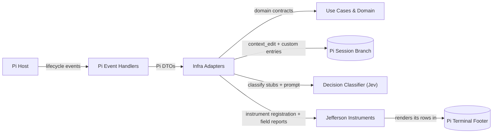

# ARCHITECTURE.md

`pi-taiknr` is a Clean Architecture Pi extension that shrinks active prompt context while keeping the session prompt prefix byte-identical for KV cache reuse, apart from the cache markers ADR 0009 moves. It replaces large tool outputs with deterministic one-line stubs after an agent run settles, stores raw outputs in session entries, and recalls relevant raw blocks at the tail of the current user message using a decision classifier.

Configuration loading, the archive half, recall and the instruments work. Both config files are read and validated at every session start, and the session's resolved state gates every handler but the config-loading `session_start`. Behind that gate, staging, settlement, the `taiknr-side-store` record and branch hydration run end to end, so a tool output at or above the session's threshold is stubbed once its run settles and the in-memory archive rebuilds from the active branch. Recall is the request half: before a provider request, taiknr scores the archive's eligible items against the newest user message and appends what it keeps to that message, for that request only, leaving every message's text and position as the host built them; on the routes ADR 0009 covers it also moves message-level cache points, so the next turn reads the recalling turn's prefix from cache instead of rewriting it. Publishing is the third half: from a session start, taiknr keeps four instruments current on the host's instrument contract, each reporting one view of the session — the context it carries, the archive, the savings and what recall is doing — from taiknr's own estimates rather than from the host's measurement. The status readout and the `/taiknr` commands do not exist yet. `test-cache-point-live.mjs` at the root is the request half's live check: three prompts on one route, and the billing inequalities read off the wire.

## 1. Project Structure

```text
src/
  app/
    extension/       Pi extension composition root: config, adapters, use cases, hooks, the gate, and the per-session instruments publisher
  config/            Configuration schema, defaults, the agent/project JSON loader, and the per-session config holder
  domain/            Pure rules: archival policies, stub formatting, recall selection, the token estimate, the context figures, the calibration ratio and the dollar rule
  use-cases/         Application ports and use cases for staging, settlement, hydration, recall and publishing
  infra/
    adapters/        Translators between Pi DTOs / APIs, the host's instrument contract, and domain/use-case contracts
    pi-event-handlers/ Thin Pi lifecycle hook registrations bridging events to adapters and use cases
tests/               Test suite, mirroring the src/ layer layout
docs/
  adr/               Architecture Decision Records
```

## 2. High-Level System Diagram

How one lifecycle event becomes a stub, a request and a footer row.



## 3. Core Components

- **Extension composition root (`src/app/extension/`):** Registers the extension with Pi, holds the per-session state its handlers share (§4), and wires configuration, adapters, use cases, and event handlers. It creates the session's config holder and the gate every registration but the config-loading `session_start` passes through, so a handler runs only while the session has a valid config with `enabled` true. It also creates one instruments holder per session, which begins as a publisher that posts nothing and is replaced by a real one when a session start turns publishing on; that ordering is what lets recall's path and the boundary handlers carry a publisher without ever testing a switch. V1 scopes `src/app/` to the Pi extension only.
- **Configuration (`src/config/`):** Resolves one session's `TaiknrConfig` from a built-in default per field, overlaid field by field by an optional agent-level JSON file and then by an optional project-level one, validating each value on the way. A present file that cannot be read or parsed, or a value that fails its rule, is a closed failure: it is reported with the file, the field where one applies and the reason, and taiknr does nothing for that session until the file is fixed, with no fallback to the defaults and none to the other file. The loader is synchronous, imports nothing from the host and takes its paths from its caller, so another entry point can reuse it. Beside it sits the per-session holder that carries the outcome to the handlers; `README.md` is the reference to the fields and their rules.
- **Domain (`src/domain/`):** Defines core types (`ToolOutputCandidate`, `ArchivedToolOutput`, `RelevanceScore`, `RecalledOutput`, `Pair`, `RatioTable`) and pure rules for archival eligibility, deterministic one-line stub rendering, the single-line normalization that stubs and argument summaries share, threshold filtering, and `<recalled_context>` block formatting. The published figures are built here too, and nothing in them touches the host: the one characters-to-tokens estimate every figure uses, the six figures and the archive's totals, the ratio a model pair is calibrated by and the uncalibrated flag's transitions, and the dollar rule with its rates, rewrite charge and net. Contains zero Pi imports.
- **Use cases (`src/use-cases/`):** Orchestrates staging large tool outputs, committing settled batches into the archive store, hydrating the store from branch history, and scoring relevance recall through the threshold, the per-message cache and the request's size budget, with fail-open handling. It also holds one publisher per session, which carries the state six publishing events share — the ratio table, the request in flight, the rewrite baseline, recall's block, the classifier spend not yet charged and the since-start totals — behind one method per event, each taking the host's values through a single deferred reading. Depends only on domain types and port interfaces, and declares the interfaces it needs from outside rather than widening an existing port.
- **Adapters (`src/infra/adapters/`):** Translates Pi-specific event DTOs and runtime objects into use-case contracts and back — mapping `TurnEndEvent` results into candidates, converting committed batches into `context_edit` (preserving non-text blocks) and `custom` boundary drafts, reading branch entries and the eligibility of the items a batch holds, invoking Pi's classifier registry, appending the tail recall block while preserving the user message's own blocks, and showing the once-per-session failure warning through `ctx.ui.notify`. The host's instrument contract is reached here as well: one module declares the four instruments, their variables and their default formats, another emits the registration and every report on the extension bus inside its own catch, and a third turns host state into the plain values a publishing event needs — the request's estimates, the projection's estimate, the window, the model pair and the branch's usage samples.
- **Pi event handlers (`src/infra/pi-event-handlers/`):** Fifteen registrations over ten events: `session_start`, `session_tree`, `session_compact`, `tool_call`, `turn_end`, `agent_before_settle`, `context_with_system`, `before_provider_request`, `message_end` and `agent_settled`. Fourteen of the fifteen register through the gate: the tool-call boundary records one top-level call's single-line argument summary, the turn boundary stages the results that turn persisted whatever its outcome, the settle boundary commits the pending items the branch still admits, the tree and compaction boundaries rebuild the archive from the branch, the request boundary scores the eligible archive against the newest user message and returns the messages with one recall block appended to that message, and the payload boundary returns the provider payload with its message-level cache points placed. The second `message_end` registration commits the carrier record that payload pass computed, at a valid assistant response and at no other. The config-loading `session_start` registers on the host API directly, because the config has to resolve even when the session that just ended was rejected or turned off. It loads the config, records the outcome on the holder, and throws the report when the load is rejected; once the config is ready and the session active, it also rebuilds the archive from the branch.
  Six of the fourteen gated registrations publish, one per event, and each is registered immediately after the registrar whose outcome it reads: the `session_start` one installs the session's publisher and posts the first figures, the `context_with_system` one publishes the request's figures after recall has returned its messages, the instruments `message_end` one publishes the saving pair and the totals at an assistant reply, and the `agent_settled`, `session_compact` and `session_tree` ones re-post what a commit or a re-hydration changed. `turn_end`, `agent_before_settle`, `before_provider_request` and the carrier record's `message_end` registration publish nothing. A publishing registrar hands its publisher one deferred reading and evaluates nothing itself, so a fault in the figures lands in that registrar rather than in recall's handler or in a settlement's drafts.

## 4. Data Stores

- **Pi session branch entries (`custom` type `taiknr-side-store`):** Persists archived raw tool outputs inside the session's JSONL tree at `agent_before_settle`, one entry per settlement, as a bare array of complete items; a shape that cannot be read that way later gets a new custom type rather than a version field (ADR 0004). Read from `getBranch()` on session start, tree navigation, and compaction, so branches and forks remain self-contained and pre-compaction outputs stay in the archive. The model never sees these entries, and the raw text they carry duplicates the text in the tool result they archive.
- **In-memory archive store:** Holds the active branch's archived items keyed by the entry id of the tool result they replace. It is an optimistic cache over the branch rather than a record of truth: Pi commits a boundary only after every handler returns and may discard one, so the store can run ahead of the branch until the next hydration replaces its contents whole.
- **Ephemeral run buffers:** Per-session maps holding tool-call argument summaries, staged candidates awaiting a settled run, and the original content of the staged tool results. An item staged in a run that never settled waits here for the next settled run, and all of it dies with the extension runtime: `/reload`, a new session or a session replacement loses whatever was still pending.
- **Payload-cache state:** One per session, created beside the recall cache: the exact text of the block this request carries, the carrier record the last request computed and the one the last valid response committed, and what the finished payload did with the block. It holds text and small records from one request to the next and is never persisted, and it sits outside the instruments switch, which only decides whether a figure reads it — the payload pass itself runs with publishing off (ADR 0009).
- **In-memory instrument state:** One publisher per session, holding the ratio table keyed by provider and model, the request in flight with the stubs and block it carried, the baseline the dollar rule measures a rewrite from, the classifier spend not yet charged, and the since-start totals. Nothing is persisted, so a session start begins at zero and the totals are labelled *since start*.
- **Configuration files (optional):** `pi-taiknr.json` in Pi's agent directory (by default `~/.pi/agent/`, and wherever `PI_CODING_AGENT_DIR` points when it is set), and the same file name in Pi's project config directory at the session's working directory, `.pi/` in a standard install. Both paths are built from Pi's helpers, never written as literals. They are read afresh at every session start — a new process, `/new`, `/resume`, `/fork` or `/reload` — and the project file only when the host reports the project trusted. No parent directory is searched, and a file may state only the fields that differ from the defaults.

## 5. External Integrations

- **Pi Coding Agent host (`@earendil-works/pi-coding-agent`):** Provides lifecycle hooks, `SessionManager` branch state, `context_edit` / `custom` boundary drafts, `ctx.modelRegistry` classifier lookup and execution, `ctx.ui.notify`, and the three request-time readings recall's budget is built from: `ctx.getContextUsage()` for the model's window, `pi.getSettings()` for the reserve pi's own threshold uses, and the package's exported token estimate over the request's messages. Declared as a peer/dev dependency only and imported exclusively inside `src/app/` and `src/infra/`.
- **Decision classifier (`openrouter` / `~typesafe/jev-latest` by default):** Invoked through Pi's `ModelRegistry.classify` API, in one call carrying one `bool` question per eligible archived item against `{ userPrompt, archivedToolOutputs }`, bounded by `classifierTimeoutMs` and attempted once. It receives the newest user message's text and each eligible item's one-line stub, never an item's raw text and never an image. A model that does not resolve, an error answer and a timeout each leave the request without recall and raise at most one warning per session; a caller's cancel raises none.
- **Jefferson (pi-jefferson 0.14.0 or later, ADR 0008):** Receives taiknr's four instruments on the `jefferson:registration` channel and one report per field on `jefferson:update`, each report a number or a boolean. It draws the footer rows from them, using taiknr's declared variables, formats and bar, and it is reached on Pi's in-process extension event bus rather than over a network. The contract has no reply channel and no signal about whether anyone listens, so taiknr posts whether or not Jefferson is loaded; every emitted report is built before it is sent, and each emit sits in its own catch, because a stale extension context throws there. Fields are cleared only when a session shuts down. `pi-jefferson` is a dev dependency pinned to an exact version for the contract's types alone: nothing imports it at runtime, and the Jefferson that runs is the user's, loaded as a package.

## 6. Deployment & Infrastructure

Runs inside the local Pi Node.js process as a Pi extension package loaded from its local checkout, named under `packages` in `~/.pi/agent/settings.json` (relative paths there resolve from `~/.pi/agent`). The manifest's `"pi": { "extensions": [...] }` names the single entry inside `src/app/extension/`, and Pi loads nothing else from the package. Nothing is packaged: `package.json` carries no `version`, `license` or `files` yet, so `npm pack` fails until the publishing card writes them. Requires no standalone daemon or database service.

## 7. Security

- Raw tool outputs stay local in the user's Pi session JSONL files, except where recall puts one into a request. What leaves goes to two destinations, and they differ: the classifier provider receives the newest user message's text and, per eligible archived output, its one-line stub (tool name, 120-unit argument summary, 180-unit preview), never the raw text and never an image; the main model's provider receives the full raw text of every output recall appends, inside the request that carries the block.
- Stubbing hides an output from the model and from nothing else: the raw text stays in the session JSONL, in the terminal UI and in exports, and the side-store record holds a second copy of it. taiknr is not a redaction or deletion tool, and a branch navigated to from before a stub shows the model the raw output again.
- **Recall sits outside the request-time redaction path.** A `context_edit` another extension persisted is enforced per request: an item whose latest edit is not taiknr's own stub is never scored and never recalled, so a persisted redaction stands. A redactor that rewrites requests at `context` time never sees recalled text, because recall attaches to `context_with_system` after those handlers run, and neither does a `context_with_system` handler registered before taiknr's; the classifier payload passes through no request-time transform at all (ADR 0007).
- Classifier invocation inherits Pi's existing provider authentication (`auth.json`); `pi-taiknr` stores no credentials of its own.
- The instruments publish sizes, counts, flags and dollars to Jefferson over Pi's in-process event bus. No archived text, no argument summary and no prompt reaches it: every field is a number or a boolean, and Jefferson renders the text its formats ask for.
- On classifier absence or failure, the extension fails open and leaves prompts unaltered rather than blocking user work or leaking raw failure internals into model context.
- A project's config file is read only when Pi reports that project trusted, so opening a repository cannot reconfigure taiknr or turn it off. The agent-level file is read on the user's own account, since only the user can write it.

## 8. Development & Testing

The package is wired for local work. Six files at the root carry the tooling: `package.json`, `package-lock.json`, `tsconfig.json`, `biome.json`, `vitest.config.ts` and `.gitignore`. The lockfile is committed, so a fresh checkout resolves the versions this repository was checked against: Biome 2.6.7, TypeScript 7.0.2, vitest 5.1.0, `@earendil-works/pi-coding-agent` 1.5.2 and `pi-jefferson` 0.14.0, the last of those for the instrument contract's types alone and pinned exactly, because a minor bump can move a member under a green check.

Three tools gate the code, in one chain behind `npm run check`:

- **Lint and format (`npm run lint`):** Biome over the allowlist `biome.json` declares, which is `src/`, `tests/` and the four root configuration files Biome reads. The run is read-only, and formatting is part of the gate, at 120 columns.
- **Types (`npm run typecheck`):** `tsc --noEmit` over `src/` and `tests/` under `nodenext` resolution, so the `.js` specifiers on `.ts` files resolve without a build step. The live-call files at the root sit outside the program.
- **Tests (`npm run test`):** vitest, collecting only `tests/**/*.test.ts`.

Tests live at the root under `tests/`, each file mirroring the `src/` layer it exercises. Pi loads only the entries its manifest names, so a root test directory is never loaded as an extension; it sits there because the sibling packages keep their suites at the root.

Two levels. Layer tests drive one handler or one use case against an in-memory branch. The suite under `tests/app/extension/` drives a real `AgentSession` over an in-memory branch and a faux model provider, so the abort, `/tree`, competing-extension, recall and compaction paths run against the host's own dispatch with no network and no model call; recall runs under a scripted classifier with a stubbed `fetch`, never the live provider.

The instruments are the exception to the layer split. A session harness rewrites every response's usage to characters ÷ 4 at zero cost, which is a ratio of about 1 and a dollar figure of 0, so the calibration ratio, the dollar rule and every response shape are driven at the handler with scripted `usage` and `cost`; the session-level suite asserts only what crossed the extension bus, captured by a listener extension. Nothing can read Jefferson's verdict, so taiknr's own declaration test asserts that every posted field is declared, of its declared type and finite.

No check enforces ADR 0001's import boundary. Only the review half of that ADR's Consequences clause is in force, and nothing in `src/domain/` or `src/use-cases/` imports a Pi package or the Jefferson contract today. Enforcement is deferred to a later card, as either a Biome rule or a check of its own.

Loading the extension for local use takes the `packages` entry described in §6. `AGENTS.md` carries the commands, conventions and traps a contributor runs into; this section does not repeat them. ADR 0003 records why the toolchain is shaped this way.

## 9. Future Considerations

- **Additional entry points (`src/app/cli/`, `src/app/mcp/`):** Planned discrete applications reusing `src/domain/` and `src/use-cases/` with filesystem/memory archive stores and standalone classifier adapters (see ADR 0001).
- **Status readout and `/taiknr` command:** Deferred past v1 (`ctx.ui.setStatus` indicators and interactive stub/score inspection). The session toggle's seam exists: the holder can flip `enabled` in memory for the rest of the session, and refuses while no valid config is loaded. Still open are the command and the readout. What the last request recalled and what recall's classifier spend came to no longer wait on them: both are published, in `taiknr.recall` and inside the net dollars, so what remains for that card is the command and the inspection itself. A mid-session flip also leaves the archive stale, because hydration runs only at a session start, a tree navigation or a compaction: a `/tree` jump taken while taiknr was off leaves a store the branch no longer matches, and the next of those events repairs it.
- **Archive scaling and threshold calibration:** Every archived item costs its raw text twice, once in the tool result and once in its side-store record, and pre-compaction `getBranch()` hydration grows the classifier input payload over very long sessions; capping or pruning stale entries and calibrating thresholds remain open future work.

## 10. Project Identification

- **Name:** `pi-taiknr` (project name: `taiknr`)
- **Owner:** Joel Leibow

## 11. Glossary

- **Stub:** A deterministic, one-line summary (`toolName`, `argsSummary`, `status`, size, and 3-line/180-char head preview) that replaces a large tool output in active session history.
- **Tail recall:** Appending relevant archived raw outputs inside `<recalled_context>` at the end of the current user message for a single provider request, leaving earlier history's text byte-identical and moving only cache markers (ADR 0009).
- **Side store (`taiknr-side-store`):** The Pi `custom` session entry carrying one settlement's archived raw outputs, as a bare array, along a branch (ADR 0004).
- **Entry id:** The identifier Pi persists for a session entry — eight hexadecimal characters normally, a 36-character UUID when it has to — carried whole and never parsed (ADR 0006).
- **Settlement (`agent_before_settle`):** The Pi lifecycle boundary after an agent run finishes where staged tool outputs are converted into persistent `context_edit` and `custom` entries.
- **Session config holder:** One session's config state — unresolved before its first session start, rejected carrying the error, or ready carrying the resolved config — created once per extension load so that two sessions never share it.
- **Hydration:** Replacing the whole in-memory archive with the items the active branch's side-store entries carry, at a session start, a tree navigation or a compaction.
- **Carry-forward:** Items staged in a run that never settled, held in the extension's runtime and committed by the next settled run that still finds them on the branch.
- **Gate:** The wrapper every registration but the config-loading `session_start` passes through. It calls a handler only while the session's config is ready and `enabled`, so a single check at registration serves every handler.
- **Instrument:** One `taiknr.<name>` view that taiknr declares to Jefferson, which draws it in the footer: `taiknr.context`, `taiknr.archive`, `taiknr.savings` and `taiknr.recall`. The user places and styles it in their own Jefferson configuration.
- **Figure:** One value taiknr posts to a declared field, such as `withheld` or `totalContext`, which a variable of an instrument's format renders into the row.
- **Calibration ratio (`k`):** One ratio per provider and model, the prompt tokens of the newest valid reply divided by the estimate of the request that produced it. Every token figure is a character estimate times the ratio for the pair it is posted under. A pair with no live sample this run is *uncalibrated*: its ratio is 1 or a seed read from the branch, and the shared flag renders `~` beside the figures.
- **Deferred reading:** The closure a publishing registrar hands the publisher instead of the host values it carries. Nothing is evaluated until the real publisher calls it, so with publishing off no projection, branch or usage read happens at all, and a fault cannot reach recall's handler or a boundary's drafts.
