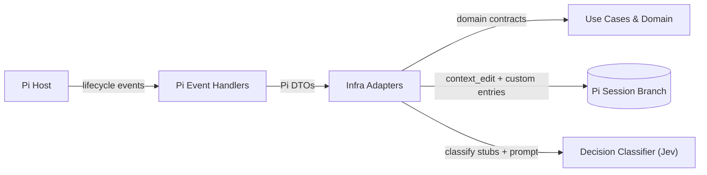

# ARCHITECTURE.md

`pi-taiknr` is a Clean Architecture Pi extension that shrinks active prompt context while keeping the session prompt prefix byte-identical for KV cache reuse. It replaces large tool outputs with deterministic one-line stubs after an agent run settles, stores raw outputs in session entries, and recalls relevant raw blocks at the tail of the current user message using a decision classifier.

The repository is currently at the stub stage: `src/` defines the module boundaries and contracts as TypeScript stubs pending implementation through the project board cards, while `jev-context-poc.ts` and `test-jev-poc.mjs` preserve the original proof of concept.

## 1. Project Structure

```text
src/
  app/
    extension/       Pi extension composition root wiring config, adapters, use cases, and hooks
  config/            Configuration schema, built-in defaults, and agent/project JSON override loader
  domain/            Pure archival policies, deterministic stub formatting, and recall selection rules
  use-cases/         Application ports and use cases for staging, settlement, hydration, and recall
  infra/
    adapters/        Translators between Pi DTOs / APIs and domain/use-case contracts
    pi-event-handlers/ Thin Pi lifecycle hook registrations bridging events to adapters and use cases
tests/               Test suite (isolated outside the extension entry directory)
docs/
  adr/               Architecture Decision Records
```

## 2. High-Level System Diagram



## 3. Core Components

- **Extension composition root (`src/app/extension/`):** Registers the extension with Pi, holds per-session ephemeral state (in-flight tool call arguments, staged outputs, recall cache), and wires configuration, adapters, use cases, and event handlers. V1 scopes `src/app/` to the Pi extension only.
- **Configuration (`src/config/`):** Resolves `TaiknrConfig` (`decisionThreshold`, `defaultDecisionModel`, `defaultDecisionModelProvider`, `minCharsToArchive`) by merging optional agent-level and project-level JSON overrides over built-in defaults.
- **Domain (`src/domain/`):** Defines core types (`ToolOutputCandidate`, `ArchivedToolOutput`, `RelevanceScore`, `RecalledOutput`) and pure rules for archival eligibility, deterministic one-line stub rendering, threshold filtering, and `<recalled_context>` block formatting. Contains zero Pi imports.
- **Use cases (`src/use-cases/`):** Orchestrates staging large tool outputs, committing settled batches into the archive store, hydrating the store from branch history, and caching/scoring relevance recall with fail-open handling. Depends only on domain types and port interfaces.
- **Adapters (`src/infra/adapters/`):** Translates Pi-specific event DTOs and runtime objects into use-case contracts and back—mapping `TurnEndEvent` results into candidates, converting committed batches into `context_edit` (preserving non-text blocks) and `custom` boundary drafts, reading branch entries, invoking Pi's classifier registry, appending tail recall blocks while preserving user image blocks, and emitting once-per-session failure warnings.
- **Pi event handlers (`src/infra/pi-event-handlers/`):** Subscribes to `session_start`, `session_tree`, `session_compact`, `tool_call`, `turn_end`, `agent_before_settle`, and `context`, delegating immediately to adapters and use cases.

## 4. Data Stores

- **Pi session branch entries (`custom` type `taiknr-side-store`):** Persists archived raw tool outputs inside the session's JSONL tree at `agent_before_settle`. Hydrated from `getBranch()` on session start, tree navigation, and compaction so branches and forks remain self-contained and pre-compaction outputs stay scorable.
- **In-memory archive store (`InMemoryArchiveStore`):** Holds the active branch's archived items keyed by Pi's 8-character `entryId` for fast lookup during a session.
- **Ephemeral run buffers and recall cache:** Per-session maps holding tool-call argument summaries, staged candidates awaiting settlement, original non-text tool result blocks, and the latest user-message recall key (`timestamp` + text) so multi-step tool loops reuse recall results without breaking intra-run prompt caching.
- **Configuration files (optional):** Agent-level `~/.pi/agent/pi-taiknr.json` and project-level `<cwd>/.pi/pi-taiknr.json`, loaded at startup over built-in defaults.

## 5. External Integrations

- **Pi Coding Agent host (`@earendil-works/pi-coding-agent`):** Provides lifecycle hooks, `SessionManager` branch state, `context_edit` / `custom` boundary drafts, `ctx.modelRegistry` classifier lookup and execution, and `ctx.ui.notify`. Declared as a peer/dev dependency only and imported exclusively inside `src/app/` and `src/infra/`.
- **Decision classifier (`openrouter` / `~typesafe/jev-latest` by default):** Invoked through Pi's `ModelRegistry.classify` API with one `bool` question per archived stub against `{ userPrompt, archivedToolOutputs }`. Fails open on missing model or runtime error, notifying the user at most once per session.

## 6. Deployment & Infrastructure

Runs inside the local Pi Node.js process as a Pi extension package loaded from its local checkout path in `~/.pi/agent/settings.json` via the `package.json` `"pi": { "extensions": [...] }` manifest. Requires no standalone daemon or database service.

## 7. Security

- Raw tool outputs remain local in the user's Pi session JSONL files unless recalled into a model prompt or sent as 1-line deterministic stubs to the configured classifier provider.
- Classifier invocation inherits Pi's existing provider authentication (`auth.json`); `pi-taiknr` stores no credentials of its own.
- On classifier absence or failure, the extension fails open and leaves prompts unaltered rather than blocking user work or leaking raw failure internals into model context.

## 8. Development & Testing

Packaging, TypeScript configuration, and the test harness are queued on the Foundation board card (`package.json`, `tsconfig.json`, and `tests/`). Once initialized, typechecking and tests will run from the repository root under `tests/` (kept outside `src/app/extension/` so Pi does not load tests as extensions).

## 9. Future Considerations

- **Additional entry points (`src/app/cli/`, `src/app/mcp/`):** Planned discrete applications reusing `src/domain/` and `src/use-cases/` with filesystem/memory archive stores and standalone classifier adapters (see ADR 0001).
- **Status readout and `/taiknr` command:** Deferred past v1 (`ctx.ui.setStatus` indicators, interactive stub/score inspection, and session toggling).
- **Archive scaling and threshold calibration:** Pre-compaction `getBranch()` hydration grows the classifier input payload over very long sessions; capping or pruning stale entries and calibrating thresholds remain open future work.

## 10. Project Identification

- **Name:** `pi-taiknr` (project name: `taiknr`)
- **Owner:** Joel Leibow

## 11. Glossary

- **Stub:** A deterministic, one-line summary (`toolName`, `argsSummary`, `status`, size, and 3-line/180-char head preview) that replaces a large tool output in active session history.
- **Tail recall:** Appending relevant archived raw outputs inside `<recalled_context>` at the end of the current user message for a single provider request, leaving earlier history byte-identical.
- **Side store (`taiknr-side-store`):** The Pi `custom` session entry carrying raw `ArchivedToolOutput` batches along a branch.
- **Settlement (`agent_before_settle`):** The Pi lifecycle boundary after an agent run finishes where staged tool outputs are converted into persistent `context_edit` and `custom` entries.
