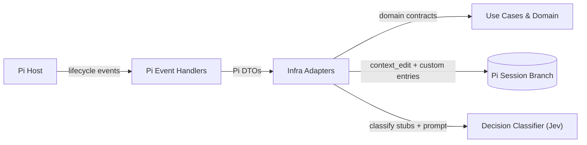

# ARCHITECTURE.md

`pi-taiknr` is a Clean Architecture Pi extension that shrinks active prompt context while keeping the session prompt prefix byte-identical for KV cache reuse. It replaces large tool outputs with deterministic one-line stubs after an agent run settles, stores raw outputs in session entries, and recalls relevant raw blocks at the tail of the current user message using a decision classifier.

Most of the repository is still at the stub stage: `src/` defines the module boundaries and contracts as TypeScript stubs pending implementation through the project board cards, while `jev-context-poc.ts` and `test-jev-poc.mjs` preserve the original proof of concept. Configuration loading is the part that works: both config files are read and validated at every session start, and the session's resolved state gates the six other handlers. The archive, recall and status behavior behind them does not exist yet.

## 1. Project Structure

```text
src/
  app/
    extension/       Pi extension composition root wiring config, adapters, use cases, and hooks
  config/            Configuration schema, defaults, the agent/project JSON loader, and the per-session config holder
  domain/            Pure archival policies, deterministic stub formatting, and recall selection rules
  use-cases/         Application ports and use cases for staging, settlement, hydration, and recall
  infra/
    adapters/        Translators between Pi DTOs / APIs and domain/use-case contracts
    pi-event-handlers/ Thin Pi lifecycle hook registrations bridging events to adapters and use cases
tests/               Test suite, mirroring the src/ layer layout
docs/
  adr/               Architecture Decision Records
```

## 2. High-Level System Diagram



## 3. Core Components

- **Extension composition root (`src/app/extension/`):** Registers the extension with Pi, holds per-session ephemeral state (in-flight tool call arguments, staged outputs, recall cache), and wires configuration, adapters, use cases, and event handlers. It creates the session's config holder and the gate the other six registrations pass through, so a handler runs only while the session has a valid config with `enabled` true. V1 scopes `src/app/` to the Pi extension only.
- **Configuration (`src/config/`):** Resolves one session's `TaiknrConfig` from a built-in default per field, overlaid field by field by an optional agent-level JSON file and then by an optional project-level one, validating each value on the way. A present file that cannot be read or parsed, or a value that fails its rule, is a closed failure: it is reported with the file, the field where one applies and the reason, and taiknr does nothing for that session until the file is fixed, with no fallback to the defaults and none to the other file. The loader is synchronous, imports nothing from the host and takes its paths from its caller, so another entry point can reuse it. Beside it sits the per-session holder that carries the outcome to the handlers; `README.md` is the reference to the fields and their rules.
- **Domain (`src/domain/`):** Defines core types (`ToolOutputCandidate`, `ArchivedToolOutput`, `RelevanceScore`, `RecalledOutput`) and pure rules for archival eligibility, deterministic one-line stub rendering, threshold filtering, and `<recalled_context>` block formatting. Contains zero Pi imports.
- **Use cases (`src/use-cases/`):** Orchestrates staging large tool outputs, committing settled batches into the archive store, hydrating the store from branch history, and caching/scoring relevance recall with fail-open handling. Depends only on domain types and port interfaces.
- **Adapters (`src/infra/adapters/`):** Translates Pi-specific event DTOs and runtime objects into use-case contracts and back—mapping `TurnEndEvent` results into candidates, converting committed batches into `context_edit` (preserving non-text blocks) and `custom` boundary drafts, reading branch entries, invoking Pi's classifier registry, appending tail recall blocks while preserving user image blocks, and emitting once-per-session failure warnings.
- **Pi event handlers (`src/infra/pi-event-handlers/`):** Subscribes to `session_start`, `session_tree`, `session_compact`, `tool_call`, `turn_end`, `agent_before_settle`, and `context`. Six of the seven register a no-op callback for their own event today, and their delegation to adapters and use cases arrives with the later board cards. Those six register through the gate; `session_start` registers on the host API directly, because the config has to resolve even when the session that just ended was rejected or turned off. Its body is the whole config bridge: build both paths from the event context, load, record the outcome on the holder, and throw the report when the load is rejected.

## 4. Data Stores

- **Pi session branch entries (`custom` type `taiknr-side-store`):** Persists archived raw tool outputs inside the session's JSONL tree at `agent_before_settle`. Hydrated from `getBranch()` on session start, tree navigation, and compaction so branches and forks remain self-contained and pre-compaction outputs stay scorable.
- **In-memory archive store (`InMemoryArchiveStore`):** Holds the active branch's archived items keyed by Pi's 8-character `entryId` for fast lookup during a session.
- **Ephemeral run buffers and recall cache:** Per-session maps holding tool-call argument summaries, staged candidates awaiting settlement, original non-text tool result blocks, and the latest user-message recall key (`timestamp` + text) so multi-step tool loops reuse recall results without breaking intra-run prompt caching.
- **Configuration files (optional):** `pi-taiknr.json` in Pi's agent directory (by default `~/.pi/agent/`, and wherever `PI_CODING_AGENT_DIR` points when it is set), and the same file name in Pi's project config directory at the session's working directory, `.pi/` in a standard install. Both paths are built from Pi's helpers, never written as literals. They are read afresh at every session start — a new process, `/new`, `/resume`, `/fork` or `/reload` — and the project file only when the host reports the project trusted. No parent directory is searched, and a file may state only the fields that differ from the defaults.

## 5. External Integrations

- **Pi Coding Agent host (`@earendil-works/pi-coding-agent`):** Provides lifecycle hooks, `SessionManager` branch state, `context_edit` / `custom` boundary drafts, `ctx.modelRegistry` classifier lookup and execution, and `ctx.ui.notify`. Declared as a peer/dev dependency only and imported exclusively inside `src/app/` and `src/infra/`.
- **Decision classifier (`openrouter` / `~typesafe/jev-latest` by default):** Invoked through Pi's `ModelRegistry.classify` API with one `bool` question per archived stub against `{ userPrompt, archivedToolOutputs }`. Fails open on missing model or runtime error, notifying the user at most once per session.

## 6. Deployment & Infrastructure

Runs inside the local Pi Node.js process as a Pi extension package loaded from its local checkout, named under `packages` in `~/.pi/agent/settings.json` (relative paths there resolve from `~/.pi/agent`). The manifest's `"pi": { "extensions": [...] }` names the single entry inside `src/app/extension/`, and Pi loads nothing else from the package. Nothing is published: `package.json` carries no `version`, `license` or `files` yet, so `npm pack` fails until the publishing card writes them. Requires no standalone daemon or database service.

## 7. Security

- Raw tool outputs remain local in the user's Pi session JSONL files unless recalled into a model prompt or sent as 1-line deterministic stubs to the configured classifier provider.
- Classifier invocation inherits Pi's existing provider authentication (`auth.json`); `pi-taiknr` stores no credentials of its own.
- On classifier absence or failure, the extension fails open and leaves prompts unaltered rather than blocking user work or leaking raw failure internals into model context.
- A project's config file is read only when Pi reports that project trusted, so opening a repository cannot reconfigure taiknr or turn it off. The agent-level file is read on the user's own account, since only the user can write it.

## 8. Development & Testing

The package is wired for local work. Six files at the root carry the tooling: `package.json`, `package-lock.json`, `tsconfig.json`, `biome.json`, `vitest.config.ts` and `.gitignore`. The lockfile is committed, so a fresh checkout resolves the versions this repository was checked against: Biome 2.6.7, TypeScript 7.0.2, vitest 5.1.0 and `@earendil-works/pi-coding-agent` 1.5.2.

Three tools gate the code, in one chain behind `npm run check`:

- **Lint and format (`npm run lint`):** Biome over the allowlist `biome.json` declares, which is `src/`, `tests/` and the four root configuration files Biome reads. The run is read-only, and formatting is part of the gate, at 120 columns.
- **Types (`npm run typecheck`):** `tsc --noEmit` over `src/` and `tests/` under `nodenext` resolution, so the `.js` specifiers on `.ts` files resolve without a build step. The proof-of-concept files at the root sit outside the program.
- **Tests (`npm run test`):** vitest, collecting only `tests/**/*.test.ts`.

Tests live at the root under `tests/`, each file mirroring the `src/` layer it exercises. Pi loads only the entries its manifest names, so a root test directory is never loaded as an extension; it sits there because the sibling packages keep their suites at the root.

No check enforces ADR 0001's import boundary. Only the review half of that ADR's Consequences clause is in force, and nothing in `src/domain/` or `src/use-cases/` imports a Pi package today. Enforcement is deferred to a later card, as either a Biome rule or a check of its own.

Loading the extension for local use takes the `packages` entry described in §6. `AGENTS.md` carries the commands, conventions and traps a contributor runs into; this section does not repeat them. ADR 0003 records why the toolchain is shaped this way.

## 9. Future Considerations

- **Additional entry points (`src/app/cli/`, `src/app/mcp/`):** Planned discrete applications reusing `src/domain/` and `src/use-cases/` with filesystem/memory archive stores and standalone classifier adapters (see ADR 0001).
- **Status readout and `/taiknr` command:** Deferred past v1 (`ctx.ui.setStatus` indicators and interactive stub/score inspection). The session toggle's seam exists: the holder can flip `enabled` in memory for the rest of the session, and refuses while no valid config is loaded. Still open are the command, the readout, and what a flip should do about the hydration a session skipped when it started off.
- **Archive scaling and threshold calibration:** Pre-compaction `getBranch()` hydration grows the classifier input payload over very long sessions; capping or pruning stale entries and calibrating thresholds remain open future work.

## 10. Project Identification

- **Name:** `pi-taiknr` (project name: `taiknr`)
- **Owner:** Joel Leibow

## 11. Glossary

- **Stub:** A deterministic, one-line summary (`toolName`, `argsSummary`, `status`, size, and 3-line/180-char head preview) that replaces a large tool output in active session history.
- **Tail recall:** Appending relevant archived raw outputs inside `<recalled_context>` at the end of the current user message for a single provider request, leaving earlier history byte-identical.
- **Side store (`taiknr-side-store`):** The Pi `custom` session entry carrying raw `ArchivedToolOutput` batches along a branch.
- **Settlement (`agent_before_settle`):** The Pi lifecycle boundary after an agent run finishes where staged tool outputs are converted into persistent `context_edit` and `custom` entries.
- **Session config holder:** One session's config state — unresolved before its first session start, rejected carrying the error, or ready carrying the resolved config — created once per extension load so that two sessions never share it.
- **Gate:** The wrapper the six non-`session_start` handlers are registered through. It calls a handler only while the session's config is ready and `enabled`, so a single check at registration serves every handler.
